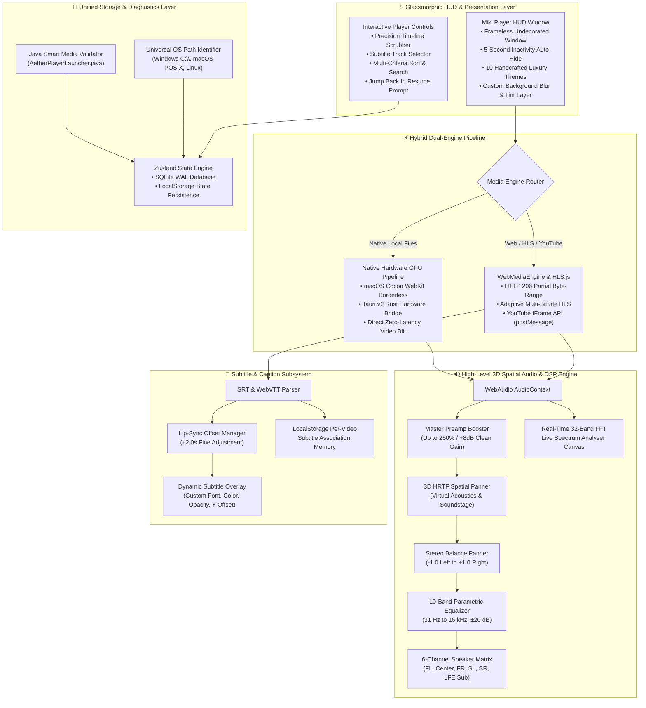

# Miki Player 🌌🎬

[](https://github.com/DinethChanuka/Miki-Video-Player)
[](https://github.com/DinethChanuka/Miki-Video-Player/actions)
[](https://v2.tauri.app/)
[](https://react.dev/)
[](https://www.typescriptlang.org/)
[](https://apple.com)
[](https://developer.mozilla.org/en-US/docs/Web/API/Web_Audio_API)
[](LICENSE)

**Miki Player** is an ultra-modern, cross-platform multimedia player and audio/video workstation designed from the ground up for high-performance video playback, studio-grade 3D spatial acoustic DSP, luxury UI customizability, and native OS integration. Engineered with a **Hybrid Dual-Engine Architecture**, it unifies native hardware GPU acceleration (macOS Cocoa + Tauri Rust + libmpv) with a high-fidelity Web Media Engine (React 19 + HLS.js + WebAudio DSP + WebGL Shaders).

---

## 🏗️ System Architecture & Data Flow



---

## 🌟 Key Highlights & Feature Deep-Dive

### 1. 🎧 3D Spatial Audio & Multi-Speaker Sound Matrix
Miki Player includes an enterprise-grade digital signal processor (DSP) powered by the WebAudio API:
- **3D HRTF Spatial Soundstage:** Real-time head-related transfer function (`PannerNode`) acoustic simulation with an interactive 2D top-down soundstage radar. Drag your listening position anywhere within 3D virtual coordinates (`normX`, `normZ`).
- **Live 32-Band FFT Spectrum Analyser:** Embedded real-time frequency visualizer canvas rendering dynamic audio spectrum bars across sub-bass, midrange, and treble.
- **250% Master Preamp Gain Booster:** VLC-style audio overdrive providing up to +8 dB of clean amplification with integrated dynamic range limiting (`DynamicsCompressorNode`) to eliminate clipping distortion on quiet laptop speakers.
- **Independent Stereo Balance Slider:** Precision panning control (`-1.0` full left to `+1.0` full right) with one-click centering.
- **6-Channel Speaker Matrix:** Individual gain calibration for Front Left, Center Dialogue, Front Right, Surround Left, Surround Right, and Low-Frequency Effects (LFE) Subwoofer crossover.
- **Binaural Acoustic Test Sweep:** Built-in one-click `Test Sweep` chime that pans a clean frequency sweep across left, center, right, and virtual surround channels to verify speaker connectivity.
- **10-Band Parametric Equalizer:** Professional 10-band graphic EQ (31 Hz, 62 Hz, 125 Hz, 250 Hz, 500 Hz, 1 kHz, 2 kHz, 4 kHz, 8 kHz, 16 kHz) with ±20 dB adjustment and preset profiles (Bass Boost, Vocal Clarity, Rock, Electronic, Flat, Cinema).

### 2. 💬 Subtitle & Closed Caption (CC) Subsystem
- **Multi-Format Support:** High-speed streaming parser for SubRip (`.srt`) and WebVTT (`.vtt`) subtitle files.
- **Automatic Path Memorization:** When you load subtitles for any local or network video, Miki Player automatically links and remembers the subtitle path and synchronization settings in persistent storage. Next time you open the video, your captions appear automatically.
- **Lip-Sync Sync Offset Calibration:** Real-time timing adjustment with millisecond precision (`-2.0s` to `+2.0s` in `0.1s` steps) to eliminate audio-dialogue desynchronization.
- **Interactive Visual Customizer:**
  - **Font Size:** Small, Medium, Large, Extra-Large.
  - **Color Palette:** Pure White, Amber Gold, Cyber Cyan, Neon Lime.
  - **Background Box Opacity:** Full range slider from `0%` (transparent text shadow) to `100%` (high-contrast black box).
  - **Vertical Positioning:** Bottom, Middle, or Top of screen.

### 3. ✨ Anime4K & Super-Resolution Video Shaders
Enhance low-resolution streams, anime, and classic movies in real time with GPU-accelerated post-processing:
- **Anime4K Edge Sharp:** Enhances line art crispness, eliminates edge halos, and restores animated detail.
- **Contrast Adaptive Sharpening (CAS):** Dynamic high-frequency detail boost without ringing artifacts.
- **Cinematic HDR Tone Mapping:** Expands dynamic range, enriches deep shadows, and prevents blown-out highlights.
- **Vivid Vibrance:** Color vibrancy and saturation enhancement for nature documentaries and live music.
- **Night Vision Boost:** Intelligent gamma lifting for dark or underexposed scenes.
- **YouTube-Style Ambient Glow:** Projects real-time blurred peripheral colors behind the player viewport onto the background glass layer.
- **Interactive Split-Screen Slider:** Real-time side-by-side comparison slider to inspect original footage against the enhanced shader output.

### 4. 📺 YouTube Engine & Exact Playback Resume
- **Universal URL Parsing:** Paste any YouTube link (`youtube.com/watch?v=...`, `youtu.be/...`, shorts, or embed URLs) directly into the player.
- **Dedicated IFrame API Architecture:** Full bidirectional `postMessage` synchronization with custom play/pause/seek controls.
- **Stop-Position Memory:** Saves your exact stopped timestamp (to the second) on pause, scrub, or window close.
- **Resume Prompt:** When clicking a previously played YouTube card, Miki Player asks whether to **Resume from stopped position** or **Start from the beginning**.
- **YouTube Stream Cards:** Saves streamed YouTube videos into clean preview cards with high-resolution thumbnail images (`img.youtube.com/vi/{id}/mqdefault.jpg`).

### 5. 🎨 10 Luxury Themes & Custom Glass Wallpaper Engine
- **10 Handcrafted Visual Themes:**
  1. **Cyberpunk Neon:** High-contrast neon cyan and hot magenta laser glow.
  2. **Midnight OLED:** Ultra-deep obsidian black with pure silver frost accents.
  3. **Tokyo Violet:** Cinematic deep indigo and fluorescent purple glow.
  4. **Matrix Emerald:** Deep dark forest with vibrant electric emerald green.
  5. **Sunset Horizon:** Warm golden amber, coral, and glowing rose red.
  6. **Glacier Frost:** Arctic blue, crystalline ice cyan, and pure silver.
  7. **Royal Obsidian:** Prestige obsidian black and champagne gold luxury.
  8. **Crimson Velvet:** Bold ruby crimson and deep dark neon burgundy.
  9. **Retro Synthwave:** 80s arcade neon pink, laser cyan, and deep purple.
  10. **Nordic Frost:** Minimalist Scandinavian matte steel and fog glass.
- **Custom Glass Wallpaper Layer:**
  - Extended canvas coverage (`-inset-10 scale-105`) preventing bleached edges.
  - Dynamic opacity slider (`0%` to `100%`).
  - Dynamic Gaussian blur slider (`0px` to `80px`).
  - 5 Glass Tints: **Obsidian Glass**, **Deep Navy**, **Aurora Emerald**, **Amethyst Velvet**, and **Ultra Clear**.
  - Built-in wallpaper presets (Deep Nebula, Liquid Glass, Cyberpunk Neon, Aurora Borealis, Dark Abstract, Synthwave Sunset) or upload your own image.

### 6. 📂 Fast Demo Streams & Multi-Criteria Sorting
- **Categorized Demo Catalog:** Fast, CORS-enabled, 100% verified demo streams sorted into:
  - `Animation & Movies` (Big Buck Bunny, Sintel, Tears of Steel)
  - `Adaptive HLS` (Mux Adaptive Multi-Bitrate, Apple 16:9 HLS)
  - `Sci-Fi & VFX` (Cosmos Laundromat, Blender Open VFX)
  - `4K & Nature` (4K 60fps Wildlife Stream)
  - `Hi-Fi Audio` (FLAC & Multichannel Audio Demonstrations)
- **Multi-Criteria Sorting:** Sort Demo Streams, YouTube History, and Recent Media by:
  - **Date Added / Viewed**
  - **Title (Alphabetical)**
  - **Duration**
  - **Playback Progress Percentage**
  - **Ascending / Descending Toggle**

### 7. 🛡️ Universal Multi-OS Path Management & Java Diagnostics
- **OS-Aware Path Identifier:** Automatically identifies host OS (`windows`, `macos`, `linux`) and standardizes slashes (`C:\Users\username\...` vs `/Users/username/...`).
- **Configurable Screenshot Directories:** Includes one-click OS presets for `Pictures/MikiPlayer`, `Videos/MikiPlayer`, `Desktop/MikiPlayer`, and `Downloads/MikiPlayer`.
- **Java Smart Media Validator:** Integrated with `AetherPlayerLauncher.java`:
  ```bash
  java AetherPlayerLauncher --validate "/path/to/video.mp4"
  ```
- **Enhanced Smart Alert System:** If a file has been moved or deleted from disk, Miki Player displays a smart modal offering a 1-click `[Remove from Recents]` button instead of throwing an unhandled error.

---

## 💻 Universal Cross-Platform Compilation & Deployment Guide

Miki Player compiles to dedicated standalone packages across **macOS**, **Windows**, **Linux**, **Android (APK)**, and **iOS**. All generated release packages are placed into the `Build/` directory structure:

```
Build/
├── MacOs/        # macOS standalone application & ZIP distribution
│   ├── Miki Player.app
│   └── Miki-Player-macOS.zip
├── windows/      # Windows standalone executable & NSIS installer
│   ├── Miki-Player.exe
│   └── Miki-Player-Setup.exe (or .msi)
├── Linux/        # Linux standalone binary, Debian package & ISO
│   ├── Miki-Player.AppImage
│   ├── miki-player.deb
│   └── Miki-Player-Linux-v0.2.0.iso
├── Android/      # Android package (Release & Debug APK)
│   └── Miki-Player-release.apk
└── ios/          # iOS application bundle & IPA
    └── Miki-Player.ipa
```

---

### 1. 🍏 macOS Packaging (.app & .zip)
Miki Player features a native Swift Cocoa borderless runner that embeds the high-performance WebKit engine.

**Build Command:**
```bash
# Clean, compile, generate AppIcon.icns, Info.plist, and package to Build/MacOs/
npm run package:mac
```
**Output:**
- `Build/MacOs/Miki Player.app` (Native double-clickable macOS application)
- `Build/MacOs/Miki-Player-macOS.zip` (Compressed distribution archive)

---

### 2. 🪟 Windows Compilation (.exe & .msi)
Powered by Tauri v2 with Windows Resource Compiler 3.00 compliance.

**Prerequisites:**
- Node.js 20+
- Rust Stable (`rustup default stable`)
- Microsoft Visual C++ Build Tools (MSVC)

**Build Commands:**
```bash
# 1. Ensure Windows 3.00 compliant icon resource is generated
npm run generate:ico

# 2. Compile React bundle and build standalone Windows executable
npm run package:win
# OR run the Windows batch script:
.\scripts\build-windows-exe.bat
```
**Output:**
- `Build/windows/Miki-Player.exe` (Standalone portable executable)
- `Build/windows/Miki-Player-Setup.exe` (NSIS installer)

---

### 3. 🐧 Linux Packaging (.AppImage, .deb & .iso)

**Prerequisites (Ubuntu/Debian):**
```bash
sudo apt-get update
sudo apt-get install -y libwebkit2gtk-4.1-dev build-essential curl wget file libssl-dev libgtk-3-dev libayatana-appindicator3-dev librsvg2-dev genisoimage
```

**Build Commands:**
```bash
# Build web production bundle & Tauri Linux binaries
npm run build
npx tauri build
```
**Output:**
- `Build/Linux/Miki-Player.AppImage` (Self-contained executable)
- `Build/Linux/miki-player.deb` (Debian/Ubuntu install package)
- `Build/Linux/Miki-Player-Linux-v0.2.0.iso` (Distributable hybrid ISO)

---

### 4. 🤖 Android Packaging (Release & Debug APK)

**Prerequisites:**
- Java Development Kit (JDK 17)
- Android SDK & NDK (API Level 34+, Build Tools 34.0.0+)
- Rust Android Targets:
  ```bash
  rustup target add aarch64-linux-android armv7-linux-androideabi x86_64-linux-android
  ```

**Build Command:**
```bash
# Automatically builds web assets and compiles the Android APK
npm run package:android
# OR run directly:
./scripts/package-android.sh
```
**Output:**
- `Build/Android/Miki-Player-release.apk`
- `Build/Android/Miki-Player-debug.apk`

---

### 5. 📱 iOS Packaging (.ipa & .app)

**Prerequisites:**
- macOS with Xcode 15+ & Command Line Tools
- Rust iOS Targets:
  ```bash
  rustup target add aarch64-apple-ios aarch64-apple-ios-sim x86_64-apple-ios
  ```

**Build Command:**
```bash
npm run package:ios
# OR run directly:
./scripts/package-ios.sh
```
**Output:**
- `Build/ios/Miki-Player.ipa`
- `Build/ios/Miki Player.app`

---

## ⚡ Automated GitHub Actions CI/CD Pipeline

Miki Player features a fully automated cross-platform continuous integration and deployment pipeline configured in [`.github/workflows/build-crossplatform.yml`](.github/workflows/build-crossplatform.yml). Every push or pull request automatically compiles:
1. **Windows Runner (`windows-latest`):** Compiles 64-bit `.exe` and `.msi` installers.
2. **Linux Runner (`ubuntu-22.04`):** Compiles `.AppImage`, `.deb`, and packages a hybrid `.iso`.
3. **Android Runner (`ubuntu-latest`):** Configures JDK 17, Android SDK/NDK, compiles Rust native libraries, and builds signed/unsigned `.apk` artifacts.
4. **iOS Runner (`macos-latest`):** Configures Xcode, builds the WebKit/Cocoa wrapper, and produces iOS distribution bundles.

All binaries are automatically packaged and published as downloadable GitHub Actions artifacts.

---

## ⌨️ Keyboard Shortcuts & Gesture Controls

| Key / Gesture | Function |
| :--- | :--- |
| `Space` / `Click Viewport` | Toggle Play / Pause |
| `←` / `→` | Seek Backward / Forward 5 seconds |
| `J` / `L` | Seek Backward / Forward 10 seconds |
| `↑` / `↓` | Volume Up / Down (10% increments up to 250% Preamp Overdrive) |
| `M` | Toggle Mute / Unmute |
| `F` / `Double Click Viewport` | Toggle Fullscreen Mode |
| `C` | Toggle Subtitles / Closed Captions (CC) |
| `S` | Capture High-Resolution Snapshot to configured OS folder |
| `[` / `]` | Lip-Sync Subtitle Offset Fine-Tuning (`±0.1s`) |
| `>` / `<` | Playback Speed Cycle (`0.5x`, `1.0x`, `1.25x`, `1.5x`, `2.0x`) |
| `E` | Open 10-Band Graphic Equalizer Modal |
| `P` | Open Player Settings & 3D Spatial Audio Panel |
| `O` / `L` | Open Media Explorer & Streams Modal |
| `Esc` | Close Open Modals / Exit Fullscreen |

---

## 📁 Project Directory Structure

```
Miki-Player/
├── .github/
│   └── workflows/
│       └── build-crossplatform.yml   # Multi-OS CI/CD Pipeline (Win, Linux, Android, iOS)
├── Build/                            # Centralized Distribution Directory
│   ├── MacOs/                        # Miki Player.app & Miki-Player-macOS.zip
│   ├── windows/                      # Miki-Player.exe & Setup.exe
│   ├── Linux/                        # .AppImage, .deb & .iso
│   ├── Android/                      # Miki-Player.apk
│   └── ios/                          # Miki-Player.ipa
├── scripts/
│   ├── package-mac.sh                # macOS Swift Cocoa packaging script
│   ├── package-android.sh            # Android APK build pipeline script
│   ├── package-ios.sh                # iOS build pipeline script
│   ├── build-windows-exe.bat         # Windows local batch build script
│   └── generate-windows-ico.cjs      # Windows 3.00 compliant DIB ICO generator
├── src/
│   ├── components/
│   │   ├── hud/
│   │   │   ├── ControlsOverlay.tsx   # Premium floating controls & scrubber
│   │   │   ├── FileBrowserModal.tsx  # Categorized demo streams & multi-criteria sorting
│   │   │   ├── VideoSettingsModal.tsx# 10 Themes, Wallpapers, 32-Band FFT, DSP & Paths
│   │   │   ├── EqualizerModal.tsx    # 10-Band Parametric Graphic EQ
│   │   │   ├── ResumeChoiceModal.tsx # Jump Back In resume or restart prompt
│   │   │   └── ErrorToast.tsx        # Smart alerts & Java diagnostic notifications
│   │   ├── player/
│   │   │   ├── SubtitleOverlay.tsx   # Synchronized closed captions & lip-sync
│   │   │   └── YouTubePlayer.tsx     # YouTube IFrame API & stop-position tracker
│   │   └── splash/
│   │       └── SplashScreen.tsx      # Startup branded intro animation
│   ├── core/
│   │   ├── SpatialAudioEngine.ts     # 3D HRTF acoustics, Preamp boost & Spectrum FFT
│   │   ├── SubtitleManager.ts        # SRT & WebVTT parser & video memory database
│   │   └── PlayerEngine.ts           # Anime4K shaders, CAS & video filters
│   ├── store/
│   │   └── playerStore.ts            # Zustand unified player state & persistence
│   ├── utils/
│   │   └── pathUtils.ts              # OS detection (Win/Mac/Linux) & path formatter
│   ├── types/
│   │   └── theme.ts                  # 10 Luxury glassmorphic theme palettes
│   ├── App.tsx                       # Root application container & HUD layout
│   └── main.tsx                      # React 19 entry point
├── src-tauri/
│   ├── Cargo.toml                    # Rust Tauri v2 desktop & mobile manifest
│   ├── tauri.conf.json               # Tauri v2 window & cross-platform config
│   └── icons/                        # Multi-resolution icons & 3.00 format ICO
├── AetherPlayerLauncher.java         # Standalone Java media file validator
├── MikiPlayerApp.swift               # Native macOS Cocoa borderless window runner
├── package.json                      # Project dependencies & build scripts
├── tsconfig.json                     # TypeScript strict configuration
└── vite.config.ts                    # Vite 6 bundler configuration
```

---

## 🛠️ Troubleshooting & FAQ

<details>
<summary><b>1. Video displays a codec unsupported error</b></summary>

Most web browsers cannot natively decode proprietary HEVC (H.265) or DTS audio. Miki Player automatically attempts to fallback to the native hardware GPU engine. For network streams, ensure standard H.264 (AVC) or VP9 encoding is used.
</details>

<details>
<summary><b>2. Subtitles appear slightly out of sync</b></summary>

Use the `[` and `]` keyboard shortcuts or open `Settings -> Tools & Captions` to adjust the lip-sync timing by `±0.1s`. Your preference is automatically memorized for that specific video.
</details>

<details>
<summary><b>3. Windows build RC2175 resource compiler error</b></summary>

If Microsoft `RC.EXE` reports error `RC2175: resource file ... icon.ico is not in 3.00 format`, run `npm run generate:ico`. This executes `scripts/generate-windows-ico.cjs` to generate an uncompressed BMP DIB icon resource compliant with Windows 3.00 specifications.
</details>

<details>
<summary><b>4. Audio clipping at 250% Preamp boost</b></summary>

Miki Player's `DynamicsCompressorNode` automatically manages headroom. If your source video has heavily clipped audio masters, simply reduce the preamp slider to 100%–120% in `Settings -> 3D Sound & Speakers`.
</details>

---

## 📜 License & Acknowledgments

Miki Player is licensed under the open-source **[MIT License](LICENSE)**.
- **HLS.js:** Video streaming over HTTP Live Streaming protocol.
- **Tauri:** Next-generation lightweight native application runtime.
- **Anime4K:** High-quality real-time anime upscaling shader algorithms.
- **Lucide Icons:** Clean, modern UI iconography.
- **Blender Open Movie Project:** Test demo footage courtesy of the Blender Foundation (CC-BY).
